# AutoScientists · 可复核的研究实验

[](https://github.com/shentonyan/autoscientists/actions/workflows/ci.yml)


本仓库把研究问题变成可检查的实验：**先写假设与失败条件，再冻结配置、运行、交叉复核，最后公开结果。**
我们在这个框架上开展了受 AQuA 启发的受限搜索、加密资产策略和神经网络预测实验。
这里既展示有效的局部发现，也保留没有通过检验的结果。

**目前结论：受限拍卖任务中的数值搜索改进获得支持；真实市场实验尚未证明稳定的扣成本收益，也尚未复现或超越原论文表现。**
模型训练可重复、程序通过复核，与策略有经济收益是两件事。

[实验总览](#results) · [搜索与现货](#search-spot) · [期货事件](#futures) · [季度检验](#walk-forward) · [BTC 模型](#btc-model) · [美股模型](#equity) · [快速运行](#try-it-in-two-minutes)

<a id="results"></a>

## 实验总览

| 实验 | 数据／独立测试期 | 关键记录 | 可以得出的结论 | 证据入口 |
|---|---|---|---|---|
| **1. 受限搜索与验证记忆** | 数值拍卖；40 个配对随机种子 | 相对 IID 的平均测试效用增量 **+0.002028**，95% 区间 **[0.001065, 0.002991]** | 在该数值任务和固定预算内有改进；不是 LLM 科研能力证明 | [L2 报告](reports/aqua-search-pilot.md) |
| **2. 现货因子与岭回归** | BTC／ETH／BNB；2024 年 5—6 月 | 选中因子 IC **0.066783**；单向 1 bp 成本后组合收益 **−25.173%** | 正 IC 没有转化为获利，未证明记忆改善交易效果 | [回测指标](research/results/crypto-v1/metrics.json) |
| **3. OI／反弹／流量事件** | BTC 永续；2024 年第四季度 | **19 笔**测试交易；算术损益 **−2.577%** | 未达到活动量要求；收益及增量收益假设无定论 | [L3 报告](reports/aqua-futures-events.md) |
| **4. 季度滚动策略选择** | BTC 永续；2025 年第二至四季度 | 三个季度均选空仓；**0 笔、0 损益** | 没有找到通过验证筛选的交易策略，不能把空仓当成盈利 | [L3 报告](reports/aqua-walk-forward.md) |
| **5. CNN／注意力独立确认** | BTC 永续；2026 年 1—9 月 | 选中 CNN 的 IC **0.005891**，区间包含零；未证实优于 GRU | 四项确认假设均无定论；验证阶段决定空仓 | [L3 报告](reports/aqua-hybrid-confirmation.md) |
| **6. 美股分钟面板** | AAPL／MSFT／JPM／XOM；2021 年—2025 年 7 月 | 选中 CNN 的 IC **−0.009332**；算术损益 **−19.208%**；日收益年化 Sharpe **−0.930** | 正向收益假设被否定，预设联合成功标准未达到 | [L2 报告](reports/aqua-equity-proxy.md) |

**口径说明：**实验 2 的 IC 是逐资产时序 Spearman 相关的均值，收益采用回测组合的复利口径；
实验 5 是单合约全测试期 Pearson IC；实验 6 是逐股票 Pearson IC 的均值。
实验 3、4、6 的损益相对固定初始名义本金按算术相加。
这些数字来自不同市场、时期和交易规则，**不构成跨实验的统一收益排名**。
L2／L3 是计算与来源记录的复核等级，不是盈利评级；实验 2 的独立审计不等于实验卡 L2 认证。

<a id="search-spot"></a>

## 实验 1–2：受限搜索与现货回测

**要检验什么：**在相同评估次数下，验证阶段积累的信息能否改善候选搜索？这种改进是否也能体现在真实行情中？

| 设置 | 实验设计 |
|---|---|
| 拍卖搜索 | 严格声明式候选接口；40 个固定种子，每种策略各 12 次评估；记忆引导的区间细化与 IID 随机搜索配对比较 |
| 现货数据 | BTCUSDT、ETHUSDT、BNBUSDT 的五分钟 K 线，2024 年 1—6 月；18 个公开归档均通过校验和检查 |
| 现货划分 | 1—3 月训练，4 月验证，5—6 月测试；每资产 2,927 个边界清洗后的非重叠 30 分钟测试区间 |
| 交易对照 | 预设因子候选与岭回归；验证集选参数，执行延迟、换手成本及最终平仓均计入 |

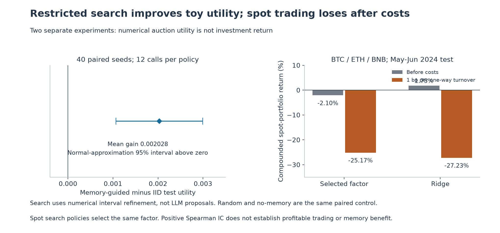

[SVG 矢量图](docs/img/aqua-search-spot-results.svg)

拍卖任务的平均测试效用增量为 **0.002028**，正态近似 95% 区间为 **[0.001065, 0.002991]**；
280 次声明的非法候选尝试全部被拒绝。但这是带区间细化先验的数值搜索；
随机与无记忆方法是同一个配对对照，并没有调用 LLM，也不能外推为语义记忆或科研能力提升。

| 现货测试预测器 | 平均 Spearman IC | 未扣成本收益 | 单向 1 bp 成本后收益 | 扣成本年化 Sharpe |
|---|---:|---:|---:|---:|
| 选中因子 | 0.066783 | −2.103% | **−25.173%** | −9.808 |
| 岭回归 | 0.002960 | +1.745% | **−27.234%** | −10.401 |

两种因子搜索策略选中了同一个候选，因此本轮没有证明记忆改善实际交易结果。
“预测相关性为正”也不足以证明组合收益为正，换手成本会进一步改变结论。

[完整设计与局限](docs/AQUA_PILOT.md) · [拍卖卡](cards/aqua-search-pilot.json) · [拍卖运行记录](runs/8a7a3667c87d41e8.json) · [现货指标](research/results/crypto-v1/metrics.json)

<a id="futures"></a>

## 实验 3：持仓量与买入流量事件

**要检验什么：**去杠杆阶段的 OI 下降、价格反弹及较弱主动买入流量，能否构成有收益的做空信号？

采用 BTC USD-M 永续的价格、持仓量、主动买入量和资金费率。
2024 年 7—8 月训练、9 月选参数、10—12 月独立测试。
训练分位数与流量阈值构成六个候选配置，验证阶段选完整过滤器及参考策略；
持仓量可用时间采用额外五分钟延迟假设，信号后再等待一根完整 K 线执行，持有 30 分钟并清洗跨边界标签。
历史真实发布时间尚未得到独立确认。

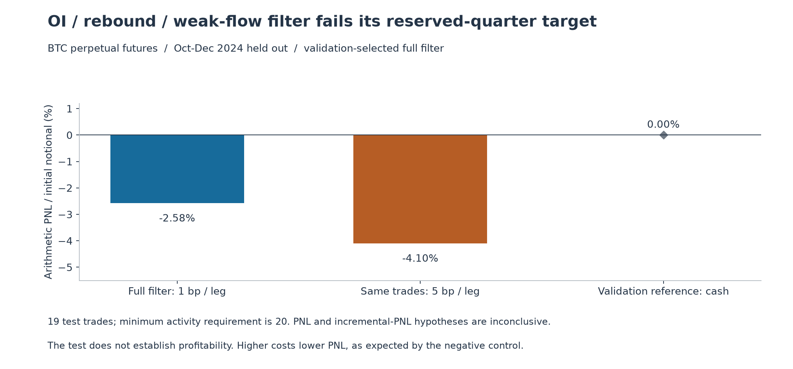

[SVG 矢量图](docs/img/aqua-futures-results.svg)

| 指标 | 独立测试结果 |
|---|---:|
| 测试样本／交易数 | 4,413 个区间／19 笔 |
| 每边 1 bp 成本后的算术损益，含资金费率 | **−2.5772%** |
| 相同交易、每边 5 bp 压力成本后的损益 | **−4.0972%** |
| 验证阶段选中的参考 | 空仓 |

预设至少需要 20 笔测试交易，实际未达到；日均损益区间也包含零。
因此收益和相对参考的增量收益假设均无定论。增加成本降低损益，符合负对照预期。
不能在看过这一测试季度后，改选表现更好的参考规则并将其宣称为独立成功。

[完整设计](docs/AQUA_FUTURES.md) · [实验卡](cards/aqua-futures-events.json) · [运行记录](runs/3dadd638fe75c9ca.json)

<a id="walk-forward"></a>

## 实验 4：季度滚动选择

**要检验什么：**将单次事件研究改为滚动选择，并允许空仓，是否能在后续季度稳定获利？

训练从 2024 年 7 月起扩展，测试前一季度作验证；2025 年第二、三、四季度逐轮测试。
候选为 **12 个 OI／反弹／买入流量规则加空仓**。
非空仓候选至少需要 20 笔验证交易，按日均收益减去 1.645 倍标准误选择；
该惩罚分数是选择启发式，不是多重选择校正后的置信下界。
基础成本每边 2 bp、压力成本每边 5 bp。

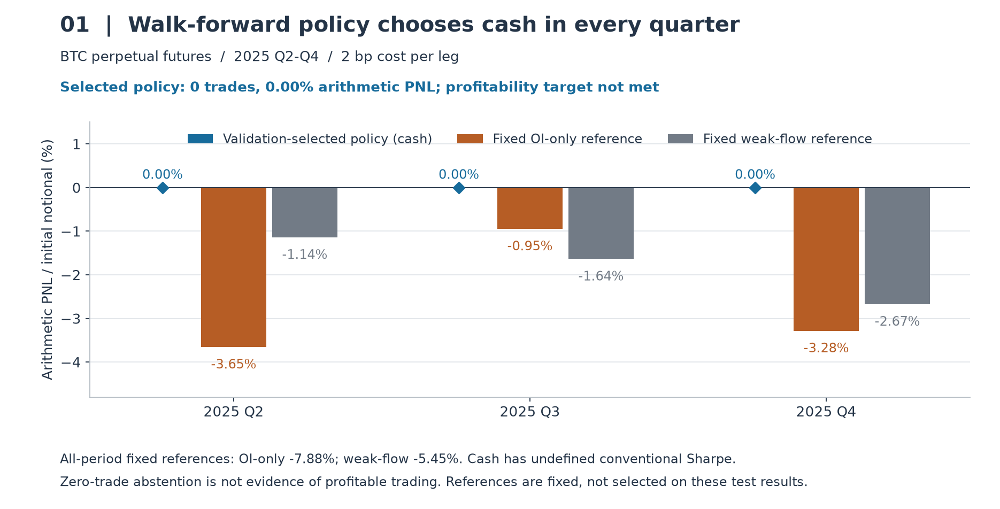

[SVG 矢量图](docs/img/aqua-walk-forward-results.svg)

三个季度全部选中空仓，交易数和算术损益均为零。
固定 OI-only 参考在全测试期损益 **−7.8817%**，固定弱流量参考为 **−5.4505%**。
这说明预设筛选没有找到可交易规则，**不证明存在盈利优势**；
空仓的常规 Sharpe 未定义，记录中的零仅为程序约定。
收益及增量收益假设无定论，季度／压力联合条件未通过。

数据复核包含 389 个归档校验和、17,504 条样本的相同重建和 256 项原始数据标量比对。
零交易运行的记账复核本身不能验证非零交易收益；另有合成测试覆盖非零收益和费用。

[完整设计](docs/AQUA_EXTENDED.md) · [实验卡](cards/aqua-walk-forward.json) · [运行记录](runs/9ad10ec0892047f6.json)

<a id="btc-model"></a>

## 实验 5：CNN／注意力模型确认

**要检验什么：**卷积、时序注意力与门控池化能否提高独立测试预测效果，并优于 GRU？

输入为过去 64 根五分钟 K 线的 9 项因果特征，训练集归一化；额外延迟一根完整 K 线后执行，
预测非重叠 30 分钟收益。CNN32、CNN64、GRU32 各训练三个种子，共 **9 个神经网络成员**，另设岭回归对照。
模型配置、检查点、预测方向和交易阈值均只用验证集决定。

| 阶段 | 日期 | 样本数 |
|---|---|---:|
| 训练 | 2024 年 7 月—2025 年 9 月 | 21,546 |
| 验证 | 2025 年 10—12 月 | 4,415 |
| 独立测试 | 2026 年 1—9 月 | 13,103 |

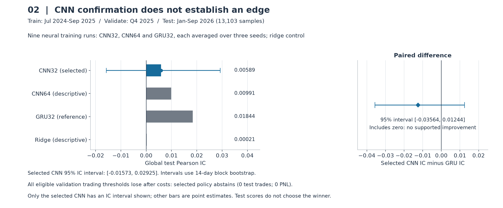

[SVG 矢量图](docs/img/aqua-hybrid-confirmation-results.svg)

| 预测器／统计量 | 测试结果 |
|---|---:|
| 验证选中的 CNN32：全局 Pearson IC | **0.005891** |
| CNN32 的 95% 区间 | **[−0.015730, 0.029251]** |
| CNN64，仅作描述 | 0.009911 |
| GRU32 参考 | 0.018437 |
| 岭回归，仅作描述 | 0.000205 |
| CNN32 减 GRU 的 IC：95% 配对区间 | **[−0.035642, 0.012438]** |

14 天分块 bootstrap 的两个关键区间均包含零，未证实正向预测优势或相对 GRU 的提升。
所有合格验证交易阈值扣成本后亏损，预设规则决定空仓：测试 0 笔、0 损益，四项假设均无定论。
描述性测试分数不能用于重新选模型。

完整九成员训练在同一环境重复后，导出预测完全一致；输入重建和检查点推理也通过复核。
这是**同环境可重复性**，不是收益优势或跨硬件保证；模型卡 L3 针对固定预测的评估，不认证 GPU 训练。

[完整设计](docs/AQUA_EXTENDED.md) · [实验卡](cards/aqua-hybrid-confirmation.json) · [运行记录](runs/55cf5d72f8ec4568.json) · [重复训练比对](research/model_forecasts/retraining_audit.json)

<a id="equity"></a>

## 实验 6：美股分钟面板

**要检验什么：**在更接近原论文时间划分的美股任务中，时序与跨股票注意力模型能否产生独立测试优势？

本轮**已完成**，不再是数据下载阶段。固定 AAPL、MSFT、JPM、XOM 四只股票，
收集 175 个月公开数据，仅保留纽约正常交易时段；过去 64 分钟的 11 项特征用于预测延迟执行的 30 分钟收益。
重复冲突分钟及不完整窗口被排除，不作插值。

| 阶段 | 时间 | 保留面板区间数 |
|---|---|---:|
| 训练 | 2010—2017 年 | 17,348 |
| 验证 | 2018—2019 年 | 4,435 |
| 隔离 | 2020 全年 | 不使用 |
| 独立测试 | 2021 年—2025 年 7 月 | 9,578 |

CNN32、CNN64 和 GRU32 的 Huber／IC 损失配置共五种，各用三个种子，合计 **15 个神经网络成员**，
另设岭回归。各模型共享跨股票注意力与股票身份参数；验证集选择 CNN32 + IC 损失和 GRU32 + IC 损失作为主比较。
组合做多最高分、做空最低分，各半名义本金，阈值在验证集确定；连续区间净额交易，间断平仓。

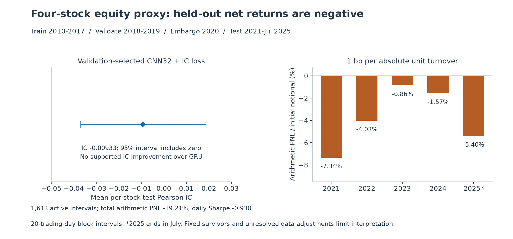

[SVG 矢量图](docs/img/aqua-equity-results.svg)

| 选中 CNN 的独立测试指标 | 结果 |
|---|---:|
| 逐股票 Pearson IC 均值 | **−0.009332** |
| IC 的 95% 区间 | [−0.036903, 0.018746] |
| 相对选中 GRU 的 IC 差异：95% 区间 | [−0.024699, 0.004628] |
| 有持仓区间数 | **1,613**，不是独立往返交易笔数 |
| 单向名义换手成本 1 bp 后算术损益 | **−19.2078%** |
| 日收益年化 Sharpe | **−0.9296** |
| 单向 5 bp 压力成本后算术损益 | **−125.3678%** |

20 个交易日分块 bootstrap 下，IC 与增量 IC 仍无定论，**日均扣成本收益区间完全为负，正向收益假设被否定**。
每个测试年份的损益均为负，五项联合成功条件全部未通过。
压力损益采用固定名义本金累加，低于 −100% 不代表模拟了实际账户的保证金或强平过程。

本轮 L2 复核覆盖预测评估、独立标量相关性和往返净额记账，不认证 GPU 训练或数据经济真实性。
四只存续股票存在幸存者限制，复权处理未核实，2025 年仅到 7 月；原始价格与预测标签不随仓库分发。
因此它是有明确范围的公开数据代理任务，不能等同于原论文完整市场的复现。

[实验设计](docs/AQUA_EQUITY_PROXY.md) · [L2 报告](reports/aqua-equity-proxy.md) · [运行记录](runs/e60e949f7ed4c1dc.json) · [数据质量摘要](research/equity_summary/quality.json) · [训练记录](research/equity_summary/training.json) · [执行与记账实现](research/equity_metrics.py)

## 这些实验补充了什么

- **受限研究接口：**注册候选、相同评估预算、验证信息记忆，以及非法候选拒绝；目前使用数值提案，尚不是 LLM 研究代理。
- **真实数据评估流程：**公开行情的校验、执行延迟、标签边界清洗、交易成本和资金费率，以及独立记账比对。
- **冻结后的确认：**滚动季度选择、神经网络对照、完整测试结果保留；不以看过测试后的优胜者替换预设策略。
- **可重复性证据：**不可变卡与运行记录、自动报告、来源哈希，以及 BTC 模型的同环境完整重复训练。

这些补充使框架能承载更具体的研究过程，但**没有证明“自动科研找到稳定赚钱策略”**。
[原论文 AQuA v3](https://arxiv.org/abs/2608.12841v3) 未公开部署因子、精确股票池和完整模型设定；
本项目的独立实现与论文原始数字应分开表述。

所有图表直接读取记录结果：[早期与美股图表来源哈希](docs/img/aqua-overview-chart-data.json)、
[季度与 BTC 模型图表数据](docs/img/aqua-confirmation-chart-data.json)。安装可选 matplotlib 后运行：

```text
python research/plot_confirmations.py
python research/plot_research_overview.py
```

以上命令只绘制已有记录，不重新训练或重选策略。框架核心仅使用标准库；量化、训练与绘图依赖分别为可选项。

## 框架如何工作

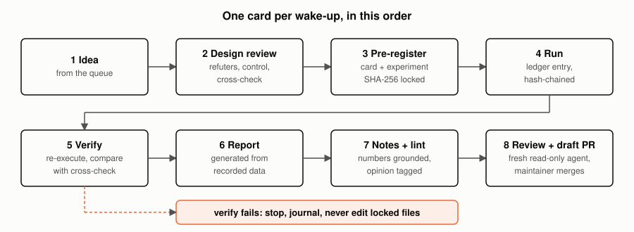

Before an experiment runs, its hypotheses and the outcomes that would refute them are
written down and hashed. After it runs, a separate step re-executes it, compares the
result with an independently computed reference, and generates the report from
recorded data. Free-text interpretation is kept apart and labelled as unverified.
`PROTOCOL.md` has the rules and their limits.

Standard library only. CI runs Python 3.10 to 3.13.

## Try it in two minutes

```
git clone https://github.com/shentonyan/autoscientists
cd autoscientists
python -m autosci --root examples/quickstart verify dice-sum
python -m autosci selftest
```

The first command re-executes a finished example and checks it against an exact
enumeration. The second corrupts a copy of the repository on purpose, 13 different
ways, and requires the verifier to notice each one. `docs/TUTORIAL.md` walks through
the example.

## What it checks

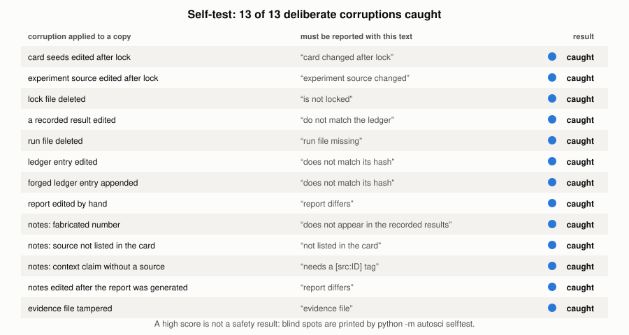

The calibration card reproduces two sealed-bid auction results known in closed form and
refutes one claim known to be false. The simulation and the closed form agree:

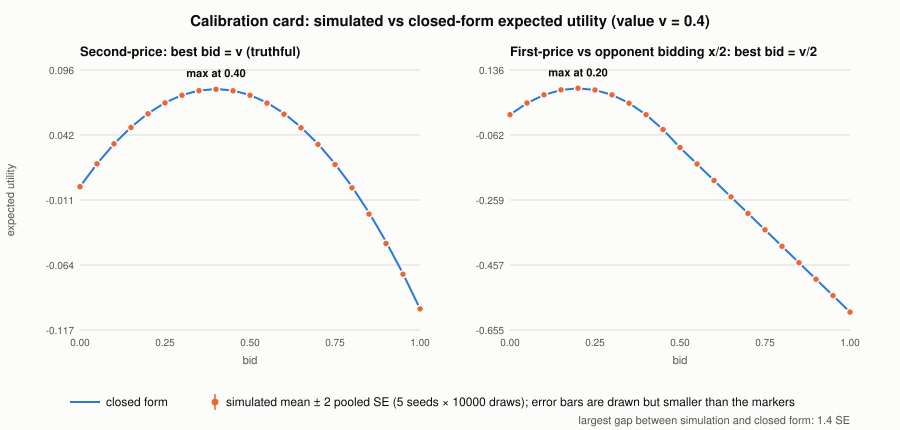

Results get an evidence level, and the ledger is hash-chained:

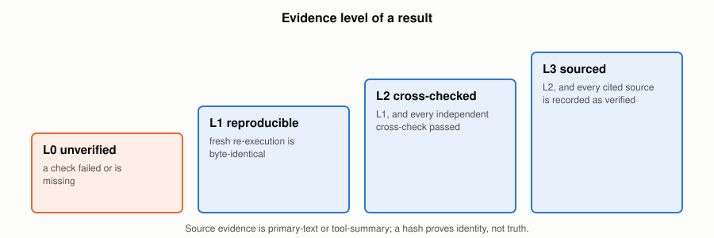

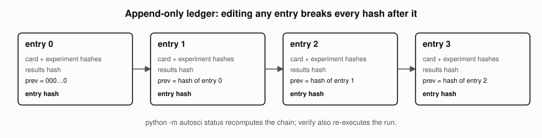

## Who may change what

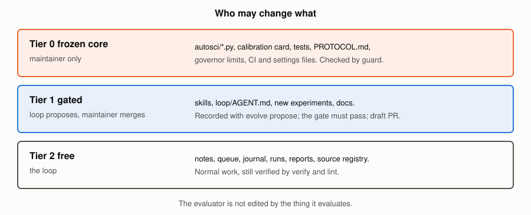

The framework's own checks are frozen: changes to them need the maintainer, and
`python -m autosci guard --base origin/main` lists them. Other parts can be proposed as
recorded variants and measured against a fixed benchmark before review
(`docs/EVOLUTION.md`).

## Using it with an AI agent

| you use | do this |
|---|---|
| Claude Code | open the repository; the `autoscientists` skill in `.claude/skills/` triggers when you give it a research idea. `CLAUDE.md` imports `AGENTS.md`. |
| another coding agent | point it at `AGENTS.md`; the procedure is `.claude/skills/autoscientists/SKILL.md` |
| no agent | run the commands yourself, see `docs/TUTORIAL.md` |

Ideas go in `state/QUEUE.md`. The agent takes one per wake-up, opens a **draft** pull
request, and stops at the first failed verification. Frequency and scheduling are up to
you; nothing in the repository schedules itself.

## Commands

```
python -m autosci new my-card        # write an empty card
python -m autosci cycle my-card      # validate, lock, run, report, verify
python -m autosci verify my-card     # re-execute and check independently
python -m autosci lint my-card       # notes: numbers and sources must be grounded
python -m autosci status             # cards, ledger chain, sources
python -m autosci govern             # should the loop stop and ask a human?
python -m autosci calibration        # how often predicted verdicts matched
python -m autosci guard --base origin/main   # changes to the frozen core
python -m autosci selftest           # corrupt a copy on purpose
python -m autosci evolve status      # variant archive
python -m unittest discover -s tests
python scripts/make_figures.py       # regenerate docs/img/*.svg
```

An experiment is a file in `experiments/` with `run`, `evaluate` and `crosscheck`.
Shapes are in `.claude/skills/autoscientists/card-schema.md`.

## Layout

| path | contents |
|---|---|
| `autosci/` | the framework (frozen core) |
| `cards/`, `experiments/` | research cards with locks; experiment modules |
| `runs/`, `reports/` | one JSON record per run; generated reports and `*.notes.md` |
| `state/` | ledger, variant archive, source registry, governor limits, manifest, queue, journal |
| `examples/quickstart/` | a complete, self-contained example |
| `.claude/` | skills, read-only reviewer agent, permission settings |
| `docs/` | `ARCHITECTURE.md`, `TUTORIAL.md`, `EVOLUTION.md`, `SURVEY.md`, figures |
| `scripts/` | figure generator |
| `tests/` | tests, including deliberate tampering |

## Limits

Checks here catch edits, missing cross-checks, uncited sources, unsupported numbers in
notes and irreproducible results. They do not establish that a question is the right
one, that a model fits reality, or that a source is correct. The independent reviewer is
the same model family as the author. See section 9 of `PROTOCOL.md`, and the FAQ in
`docs/ARCHITECTURE.md`.

## Contributing and security

See `CONTRIBUTING.md` and `SECURITY.md`. Pull requests carry a disclosure line; see
`.github/PULL_REQUEST_TEMPLATE.md`.
